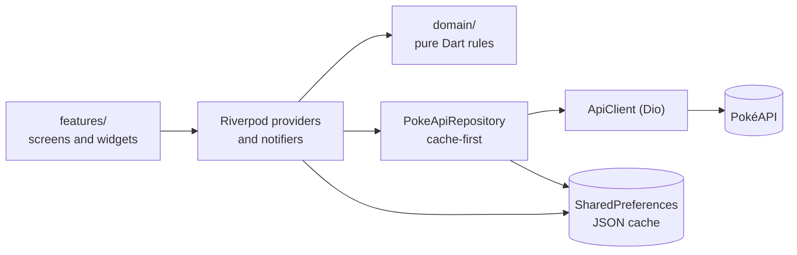

 <div align="center">

  

  <h3>Beyond the Pokédex.</h3>

  <p>An unofficial Pokémon research and discovery companion built with Flutter.</p>

  <p>
    
    
    
    
    
    
    
    
  </p>

  <p><strong>1,025 species · 9 generations · 20 achievements · 4 widget sizes · 327 tests</strong></p>

  <p>
    <strong>🎬 Full Application Demonstration</strong><br>
    <a href="https://drive.google.com/file/d/1mC15HkOd97j_yW7tOFx_2wqBNsXa5Kaf/view?usp=sharing">Watch the PokéPod Demo</a>
  </p>

</div>

<p align="center">
  
</p>

PokéPod treats the Pokédex as a **research instrument rather than just a list of Pokémon**. Explore the National Pokédex, open detailed research dossiers, track discoveries, compare specimens, analyse team compositions, organise collections, and test your knowledge with a daily *Who's That Pokémon?* challenge.

Built with Flutter and Riverpod, PokéPod combines Pokémon discovery, research progression, team analysis, personalisation, and interactive features in one mobile application.

Your research progress and personal data are stored **locally on your device**. There are no user accounts, no custom backend, and no analytics or advertising.

---

## Contents

- [Features](#features)
  - [Discover](#discover)
  - [Pokédex](#pokedex)
  - [Research Dossiers](#research-dossiers)
  - [Evolution Constellation](#evolution-constellation)
  - [Pokémon DNA](#pokemon-dna)
  - [Team Architect](#team-architect)
  - [Who's That Pokémon?](#whos-that-pokemon)
  - [Collections](#collections)
  - [Trainer Profile](#trainer-profile)
  - [Achievements and Research Journal](#achievements-and-research-journal)
  - [Android Home-Screen Widgets](#android-home-screen-widgets)
  - [Notifications and Sound](#notifications-and-sound)
  - [Settings, Backup, Help and About](#settings-backup-help-and-about)
- [Technical Architecture](#technical-architecture)
- [Data, Caching and Offline Behaviour](#data-caching-and-offline-behaviour)
- [Tech Stack](#tech-stack)
- [Getting Started](#getting-started)
- [Privacy and Data Ownership](#privacy-and-data-ownership)
- [Verification and Status](#verification-and-status)
- [Known Limitations](#known-limitations)
- [Credits and Disclaimer](#credits-and-disclaimer)
- [License](#license)

---

## Features

### Discover

The Discover dashboard brings together important research information and daily activities.

- **Specimen of the Day:** Discover a featured Pokémon, also displayed through the home-screen widgets.
- **Daily Challenge:** View today's *Who's That Pokémon?* challenge status and your current streak.
- **Research Progress:** Track overall research progress, recently viewed Pokémon, and upcoming milestones.
- **Unexpected Connections:** Explore relationships between Pokémon based on shared abilities, similar stat distributions, comparable base-stat totals, and shared evolution families. Each connection includes an explanation based on the underlying data.

<p align="center">
  
</p>

<p align="center">
  <sub><strong>Specimen of the Day</strong> — a featured Pokémon on your Discover dashboard.</sub>
</p>

### Pokédex

Explore the **National Pokédex, covering all 1,025 species across nine generations**.

- **Incremental loading:** Pokémon are loaded in batches of 30.
- **Search:** Find Pokémon by name or Pokédex number.
- **Combined filters:** Filter by type, generation, and favourites. Multiple filters can be combined and cleared in one action.
- **Sorting:** A dedicated Sort By sheet supports Pokédex number, name, generation, type, Legendary and Mythical status, favourites, height, weight, and base stats. Sorting direction adapts to the selected property.
- **Display options:** Switch between grid and compact list layouts.
- **Loading and error handling:** Loading skeletons, empty states, and retry actions provide feedback during browsing.
- **Living Dex:** Optional silhouettes represent Pokémon that have not yet been discovered.

<p align="center">
  
</p>

<p align="center">
  <sub><strong>National Pokédex</strong> — browse, search, filter, and organise Pokémon.</sub>
</p>

### Research Dossiers

Every Pokémon has a detailed research dossier containing information and tools for tracking your discoveries.

- Official and shiny artwork.
- Pokémon types, height, and weight.
- Base stats and their combined total.
- Abilities, including clearly marked hidden abilities.
- A sample of moves and the English species description.
- An evolution preview that opens the Evolution Constellation.
- A personal research log.
- Personal notes, collection management, comparison, and showcase pinning.

Research progresses through four stages:

`Unseen → Discovered → Studied → Mastered`

Opening a Pokémon's dossier automatically marks it as **Discovered**. Advancing to **Studied** and **Mastered** requires an explicit user action, one stage at a time.

### Evolution Constellation

Explore Pokémon evolution families through an interactive graph generated from PokéAPI evolution-chain data.

- Pan and zoom around the evolution graph.
- Explore branching evolution families, including Eevee.
- View multi-stage evolution chains.
- Read the conditions associated with each evolution.
- Identify the currently selected Pokémon.
- Tap any Pokémon in the graph to open its research dossier.

<p align="center">
  
</p>

<p align="center">
  <sub><strong>Evolution Constellation</strong> — explore evolution families and their branching paths.</sub>
</p>

### Pokémon DNA

Compare two Pokémon through a dedicated specimen comparison interface.

The comparison includes:

- Side-by-side base-stat bars and differences.
- Individual and combined stat totals.
- Type and ability information.
- Defensive profiles showing weaknesses, resistances, and immunities.
- Written analysis generated from the available Pokémon data.

The analysis is intended to help understand differences between specimens. Base stats alone do not predict battle outcomes.

<p align="center">
  
</p>

<p align="center">
  <sub><strong>Pokémon DNA</strong> — compare statistics, types, abilities, and defensive profiles.</sub>
</p>

### Team Architect

Build and analyse Pokémon teams with a maximum of six members.

- Create, rename, duplicate, and delete teams.
- Review defensive coverage through a type-based matrix.
- See the number of weaknesses, resistances, and immunities against each attacking type.
- Review offensive type coverage.
- Receive explainable suggestions highlighting potential coverage gaps.

Team analysis is type-based and uses STAB assumptions for offensive coverage. It does not simulate battles or model individual movesets.

<p align="center">
  
</p>

<p align="center">
  <sub><strong>Team Architect</strong> — build teams and examine their type coverage.</sub>
</p>

### Who's That Pokémon?

A daily Pokémon guessing challenge featuring one answer per local calendar day.

- **Six guesses:** Identify the mystery Pokémon within six attempts.
- **Searchable picker:** Find and select a Pokémon as your guess.
- **Progressive clues:** Reveal information about generation, type, size, and base-stat total, followed by a description with the Pokémon's name hidden, name length, and first letter.
- **Progressive artwork reveal:** The mystery artwork transitions from a question mark to a blurred silhouette, a sharper silhouette, and eventually muted colour as incorrect guesses accumulate.
- **Daily result:** A win or game-over state reveals the answer and locks the completed day.
- **Persistent statistics:** Track current streak, best streak, games played, win rate, and previous results through a collapsible history.

The daily answer-selection system is explained in [Daily Challenge Selection](#daily-challenge-selection).

<p align="center">
  
</p>

<p align="center">
  <sub><strong>Who's That Pokémon?</strong> — use clues and limited guesses to identify the mystery specimen.</sub>
</p>

### Collections

Organise discovered Pokémon and track your progress through custom collections.

- Create and manage custom collections.
- Arrange a reorderable Pokémon showcase.
- Pin favourite Pokémon.
- View **Generation Dex Progress** to track discoveries within a selected generation.
- Review research progress by Pokémon type.
- Access recently researched Pokémon.

<p align="center">
  
</p>

<p align="center">
  <sub><strong>Collections</strong> — organise Pokémon and monitor your collection progress.</sub>
</p>

### Trainer Profile

The Trainer Profile brings together personalisation and an overview of your research activity.

- Set a trainer nickname.
- Choose any Pokémon as your avatar.
- Personalise the application with a selectable accent colour.
- Switch between System, Dark, and Light themes.
- Review research statistics.
- View an achievements preview.
- Access the Research Journal containing personal notes and saved teams.

The profile's side menu provides access to Achievements, Research Journal, Settings, Help & User Guide, and About.

<p align="center">
  
</p>

<p align="center">
  <sub><strong>Trainer Profile</strong> — personalise your profile and access your research activity.</sub>
</p>

### Achievements and Research Journal

**Achievements**

PokéPod includes 20 achievements earned through research and gameplay progress.

Each achievement includes a progress bar and a rarity tier. The nine rarity tiers are:

`Common` · `Uncommon` · `Rare` · `Epic` · `Double Rare` · `Ultra Rare` · `Illustration Rare` · `Special Illustration Rare` · `Hyper Rare`

<p align="center">
  
</p>

<p align="center">
  <sub><strong>Achievements</strong> — track milestones earned through exploration and gameplay.</sub>
</p>

**Research Journal**

The Research Journal brings together personal notes recorded in Pokémon dossiers and saved teams, giving you a dedicated place to revisit your research.

<p align="center">
  
</p>

<p align="center">
  <sub><strong>Research Journal</strong> — revisit your notes and saved teams.</sub>
</p>

### Android Home-Screen Widgets

PokéPod provides four Android home-screen widget sizes:

- Compact
- Small
- Medium
- Large

Each widget displays the same Specimen of the Day as the application. Larger sizes progressively provide additional information, including Pokémon artwork, name, Pokédex number, type badges, description, height, and weight.

To add a widget, long-press the Android home screen, open **Widgets**, and select PokéPod.

<p align="center">
  
</p>

<p align="center">
  <sub><strong>Home-Screen Widgets</strong> — access the Specimen of the Day directly from your Android home screen.</sub>
</p>

### Notifications and Sound

**Local Notifications**

- Opt-in daily reminders.
- Who's That Pokémon? streak reminders.
- Scheduling based on the device's local time zone.
- An in-app explanation before the system notification permission prompt.
- No remote push-notification service.

**Sound Effects**

Short sound effects are used for the application splash screen and daily challenge. Sound effects can be disabled in Settings.

### Settings, Backup, Help and About

**Settings**

Manage application preferences, including accent colour, theme mode, and sound settings.

<p align="center">
  
</p>

<p align="center">
  <sub><strong>Settings</strong> — customise the application's appearance and preferences.</sub>
</p>

**Backup and Restore**

PokéPod provides local backup and restoration of personal progress.

- Create a versioned backup containing your progress.
- Copy the backup as text to the clipboard.
- Validate backup data before restoration.
- Preview the backup contents.
- Confirm before replacing existing data.

Backups are not automatically uploaded to a cloud service.

<p align="center">
  
</p>

<p align="center">
  <sub><strong>Backup and Restore</strong> — protect and restore your local research progress.</sub>
</p>

**Help & User Guide**

A searchable, collapsible guide provides information about the application's features and settings.

<p align="center">
  
</p>

<p align="center">
  <sub><strong>Help & User Guide</strong> — find guidance for application features and settings.</sub>
</p>

**About**

The About section provides application information, credits, open-source licence information, and the unofficial fan-project disclaimer.

<p align="center">
  
</p>

<p align="center">
  <sub><strong>About PokéPod</strong> — application information, credits, and licence details.</sub>
</p>

---

## Technical Architecture

PokéPod follows a feature-oriented architecture. Application rules and calculations are kept in plain Dart where possible, separate from Flutter presentation code.

### Architecture Overview



### Project Structure

```text
lib/
  main.dart                    entry point, loads SharedPreferences
  app/
    app.dart                   MaterialApp, theme wiring, launch splash
    shell.dart                 five-tab shell, back-to-Discover behaviour
    theme/                     design tokens (color, spacing, radii, motion) and ThemeData
    design_system/widgets.dart Panel, TypeChip, StatBar, PokemonArtwork, skeletons, states
  core/
    errors/ networking/ storage/ utils/
  data/
    models/                    hand-written, defensive PokéAPI models + compact cache formats
    repositories/              PokeApiRepository: cache-first, in-flight de-duplication
    providers.dart             repository, catalogue, detail, species, evolution providers
  domain/                      pure Dart, unit-tested: type chart, team analysis, research rules,
                               mystery logic, filters, connections, evolution layout, achievements
  features/                    discover, pokedex, pokemon_detail, evolution, analysis,
                               team_builder, mystery, collections, trainer_profile, research,
                               notifications, widgets, help, shared
test/                          unit and widget tests (no network; PokéAPI is faked)
```

### Engineering Decisions

- **Riverpod for state management and dependency injection:** A consistent mechanism provides application state, the repository, and the HTTP client. Tests can override these dependencies. GetIt from the original application was removed because Riverpod already covered these responsibilities.
- **Repository layer:** Screens do not directly handle HTTP requests. `PokeApiRepository` uses cache-first retrieval, deduplicates identical in-flight requests, and depends on a small `ApiClient` interface that can be replaced with a fake client during testing.
- **Defensive data models:** Hand-written PokéAPI models tolerate missing or malformed fields. Invalid responses are handled through typed errors rather than allowing malformed data to cause application crashes.
- **Separation of domain logic:** The type chart, team analysis, research-stage rules, filtering, sorting, evolution layout, achievements, and daily challenge logic are implemented in pure Dart and tested independently of the UI.
- **Navigation:** A swipeable `PageView` shell uses a shared selected-tab value for the bottom navigation bar, swipes, and in-app shortcuts. Deeper screens use standard `Navigator` pushes.
- **Local persistence:** User data is stored as JSON in `shared_preferences`. Data is loaded before the application starts so that notifiers can access it synchronously.

### Testing

The test suite covers:

- Model parsing, including malformed data.
- Repository caching and error handling using a fake API client.
- Filtering, sorting, and pagination.
- Persistence round-trips.
- Type-chart calculations and team analysis.
- Evolution layout.
- Daily Pokémon selection and streak rules.
- Backup validation.
- Widget tests for navigation and key application screens.

---

## Data, Caching and Offline Behaviour

PokéPod uses PokéAPI as its primary source of Pokémon data and retrieves artwork from the PokeAPI sprites repository.

- **Data source:** [PokéAPI](https://pokeapi.co).
- **Artwork source:** [PokeAPI sprites](https://github.com/PokeAPI/sprites).
- **Catalogue:** A single request retrieves the Pokémon names and numbers. Artwork URLs are derived from the Pokédex number, avoiding separate data requests for every grid tile.
- **On-demand retrieval:** Pokémon details, species descriptions, evolution chains, and type lists are retrieved when needed.
- **Caching:** Retrieved information is cached in memory and persisted locally in a compact format.
- **Offline access:** Previously opened information can be served from the local cache without a network request.
- **First-time access:** A network connection is required to retrieve information that has not previously been cached.
- **Error handling:** An offline banner appears after a request fails, and failed requests provide a retry action. The application does not fabricate missing data.
- **Artwork caching:** Artwork is cached by the image cache after loading. Images that have never been loaded cannot be displayed offline.

### Daily Challenge Selection

The daily challenge answer is determined using the device's **local calendar date**.

The full National Pokédex is shuffled using a date-seeded generator. Each day selects the next position in that shuffled order. Across a 1,025-day cycle, every species appears once.

The selection is designed to avoid a predictable relationship between consecutive days, generations, or Pokémon types.

Additional behaviour:

- The selected answer is saved the first time a day is opened.
- The answer remains unchanged for that day.
- Completed challenges cannot be replayed.
- Duplicate and invalid guesses are ignored.
- The game does not reopen a day earlier than the latest day played.
- The daily date rolls over at local midnight, including when the application remains open or returns from the background.

Because PokéPod does not use a server, changing the device clock forward cannot be prevented.

### Type Chart and Team Analysis

`lib/domain/type_chart.dart` implements the 18-type chart used since Generation VI.

Dual-type defensive multipliers include:

`0` · `¼` · `½` · `1` · `2` · `4`

Team offensive coverage is **STAB-based**. It assumes Pokémon use moves corresponding to their own types because individual movesets are not tracked.

PokéPod does not simulate battles.

---

## Tech Stack

<p>
  
  
  
  
  
  
  
  
  
  
  
</p>

| Package | Purpose |
|---|---|
| `flutter_riverpod` | State management and dependency injection |
| `dio` | HTTP requests, timeouts, retries, and cancellation |
| `shared_preferences` | Local application data persistence |
| `cached_network_image` | Pokémon artwork caching |
| `audioplayers` | Sound effects |
| `home_widget` | Android home-screen widgets |
| `flutter_local_notifications` | Local reminders and notifications |
| `flutter_timezone` | Device local time-zone handling |

---

## Getting Started

### Prerequisites

- Flutter with a Dart SDK satisfying `^3.10.0` (verified on Flutter 3.47.4).
- Android Studio or Android SDK command-line tools.
- An Android emulator or physical Android device.
- An Android device or emulator is required to test home-screen widgets and notifications.

### Installation

Clone the repository:

```bash
git clone <your-repository-url>
cd pokepod
```

Install dependencies:

```bash
flutter pub get
```

Run the application:

```bash
flutter run
```

Run commands from the project directory containing `pubspec.yaml`.

The `pubspec.lock` file is committed to the repository to support reproducible dependency resolution.

### Code Quality and Tests

Format the code:

```bash
dart format .
```

Run static analysis:

```bash
flutter analyze
```

Run the test suite:

```bash
flutter test
```

### Build Android APKs

Debug build:

```bash
flutter build apk --debug
```

Release build:

```bash
flutter build apk --release
```

> **Release signing:** The current release configuration uses the debug signing configuration inherited from the Flutter template. Configure your own release keystore and signing settings before publishing. Never commit keystores or `key.properties` to the repository.

### Android Notes

- **Home-screen widgets:** Long-press the Android home screen, open *Widgets*, and select PokéPod.
- **Notifications:** Reminders are opt-in. The application explains their purpose before requesting Android notification permission. Notification preferences can be changed later in Settings.

---

## Privacy and Data Ownership

PokéPod follows a **local-first approach** to personal data.

- **No accounts:** There is no account registration or login.
- **No custom backend:** Personal application data is not sent to a PokéPod-operated server.
- **No analytics or advertising:** The application does not include analytics or advertising.
- **Local storage:** Research progress, favourites, collections, teams, notes, profile information, and daily challenge history are stored on the device.
- **External requests:** Pokémon data is retrieved from PokéAPI, and artwork is retrieved from the GitHub-hosted PokeAPI sprites repository. These HTTPS requests necessarily expose your IP address to the respective services.
- **Clipboard backups:** Backup data is copied as text to the device clipboard. It is not automatically uploaded anywhere.
- **Uninstalling or clearing application data:** Local progress is erased. Create a backup before uninstalling if you want to preserve your data.

---

## Verification and Status

Last recorded verification environment:

- Flutter 3.47.4
- Windows
- JDK 21
- Android SDK 36

| Verification | Result |
|---|---|
| `flutter pub get` | Pass |
| `dart format lib test` | Pass — 89 files, 0 changed |
| `flutter analyze` | Pass — no issues found |
| `flutter test` | Pass — 327 tests |
| Android debug APK | Pass |
| Android release APK | Pass |
| iOS, web, macOS, Linux, Windows | Not built or tested |

The iOS, web, and desktop platform folders exist but have not been tested. Run the verification commands on your own environment to reproduce these results.

---

## Known Limitations

- **Pokédex coverage:** The catalogue includes National Dex species 1–1025. Alternate forms, including Mega and regional forms, are not included.
- **Moves:** Pokémon dossiers display a sample of moves (the first 12 alphabetically), rather than a complete move list.
- **Team analysis:** Analysis is type-based and assumes STAB coverage. Individual movesets and abilities are not modelled, and there is no battle simulation.
- **Sorting:** Sorting by type, size, base stats, or Legendary and Mythical status requires information beyond the initial catalogue. These sorts use data already saved on the device and can load missing data when requested.
- **Research by type:** This feature requires 18 small requests, loaded on demand.
- **Local cache:** Cached data is stored in `shared_preferences`. This is suitable for personal application data but is not designed for very large caches. Cached data is not refreshed automatically.
- **Platform support:** Home-screen widgets and local reminders are Android-only.
- **Device clock:** Without a server, the application cannot prevent users from moving the device clock forward.
- **Backup:** Backups are copied as clipboard text. There is no built-in file export, cloud backup, or cross-device synchronisation.
- **Release signing:** The current release configuration uses the debug signing configuration until a custom release keystore is configured.

---

## Credits and Disclaimer

- **Pokémon data:** Provided by [PokéAPI](https://pokeapi.co).
- **Pokémon artwork:** Retrieved at runtime from the [PokeAPI sprites repository](https://github.com/PokeAPI/sprites). No Pokémon artwork is stored in this repository.
- **Sound effects:** Bundled under `assets/sounds/` and sourced through Zedge. Their redistribution terms have not been independently confirmed.
- **PokéPod wordmark:** Supplied by the author.
- **Third-party packages and licences:** Package provenance, licence information, and redistribution notes are documented in [`THIRD_PARTY_NOTICES.md`](./THIRD_PARTY_NOTICES.md). The application's **About → Open-source licences** section also lists package licences.

PokéPod is an **unofficial fan project**. It is not affiliated with, endorsed by, or sponsored by Nintendo, The Pokémon Company, or Game Freak.

Pokémon and related names, characters, artwork, and other intellectual property remain the property of their respective owners. This project does not claim ownership of Pokémon intellectual property.

---

## License

PokéPod's original source code is released under the [MIT License](./LICENSE).

This licence applies to the original code authored for this project. Pokémon-related names, characters, artwork, trademarks, and other third-party materials remain the property of their respective owners and are not covered by this licence. Third-party dependencies and assets remain subject to their respective licences and usage terms.

---

<div align="center">

**Built with Flutter by [ShakyaJU](https://github.com/ShakyaJU)**

<sub>PokéPod is an unofficial fan project and is not affiliated with Nintendo, The Pokémon Company, or Game Freak.</sub>

</div>
