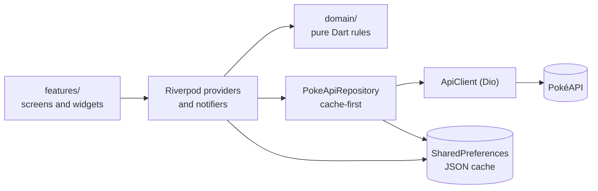

<div align="center">

<p align="center">
  
</p>

<h3>Beyond the Pokédex.</h3>

<p>An unofficial Pokémon research challenge and discovery companion built with Flutter.</p>

<p>


</p>

<p><b>1,025 species · 9 generations · 20 achievements · 4 widget sizes · 327 tests</b></p>

<p>
  <b>🎬 Watch the Full PokéPod App Demonstration</b><br><br>
  <a href="https://drive.google.com/file/d/1mC15HkOd97j_yW7tOFx_2wqBNsXa5Kaf/view?usp=sharing"></a><br>
  <sub><a href="https://drive.google.com/file/d/1mC15HkOd97j_yW7tOFx_2wqBNsXa5Kaf/view?usp=sharing">Watch the PokéPod Demo</a></sub>
</p>

<p>
  <a href="#features"></a>
  <a href="#technical-architecture"></a>
  <a href="#data-caching-and-offline-behavior"></a>
  <a href="#tech-stack"></a>
  <a href="#getting-started"></a>
  <a href="#privacy-and-data-ownership"></a>
</p>

</div>

<p align="center">
  
</p>

PokéPod treats the Pokédex as a **research instrument** rather than a list. You browse the Pokédex, open research dossiers, record what you have discovered, studied and mastered, compare specimens, build teams, organise collections and play a daily "Who's That Pokémon?" challenge.

Everything you create is stored **locally on your device**. There is no account to create and no custom backend.

<table align="center">
  <tr>
    <td align="center"><h2>1,025</h2><sub>species</sub></td>
    <td align="center"><h2>9</h2><sub>generations</sub></td>
    <td align="center"><h2>20</h2><sub>achievements</sub></td>
    <td align="center"><h2>4</h2><sub>widget sizes</sub></td>
    <td align="center"><h2>327</h2><sub>tests</sub></td>
  </tr>
</table>

<table>
  <tr>
    <td width="33%" valign="top">
      <b>A research instrument</b><br><br>
      Opening a dossier marks a Pokémon as <i>Discovered</i>. <i>Studied</i> and <i>Mastered</i> are always explicit choices, one step at a time, so your progress reflects what you actually did.
    </td>
    <td width="33%" valign="top">
      <b>Local-first</b><br><br>
      No accounts, no custom backend, and no analytics or advertising. Your progress, notes, collections, teams and game history stay on your device.
    </td>
    <td width="33%" valign="top">
      <b>Honest data</b><br><br>
      Data is cached after the first load and served offline. Analysis is generated from real data and never claims that base stats predict a battle. Nothing is fabricated.
    </td>
  </tr>
</table>

<p align="center">
  <sub><b>Jump to a feature:</b>
  <a href="#discover">Discover</a> ·
  <a href="#pokédex">Pokédex</a> ·
  <a href="#research-dossiers">Dossiers</a> ·
  <a href="#evolution-constellation">Evolution Constellation</a> ·
  <a href="#pokémon-dna">Pokémon DNA</a> ·
  <a href="#team-architect">Team Architect</a> ·
  <a href="#whos-that-pokémon">Who's That Pokémon?</a> ·
  <a href="#collections">Collections</a> ·
  <a href="#profile-and-progression">Profile and progression</a> ·
  <a href="#android-home-screen-widgets">Widgets</a> ·
  <a href="#notifications-and-sound">Notifications and sound</a> ·
  <a href="#settings-backup-help-and-about">Settings, backup, help and about</a></sub>
</p>

---

## Features

### Discover

<table>
  <tr>
    <td width="58%" valign="middle">

A dashboard that works for a brand-new user and for an experienced one.

<ul>
  <li><b>Specimen of the Day</b>, shared with the home-screen widgets.</li>
  <li><b>Who's That Pokémon?</b> card with today's status and a separate streak panel.</li>
  <li><b>Research progress</b> ring, recently viewed Pokémon and upcoming milestones.</li>
  <li><b>Unexpected Connections</b>: relationships between Pokémon, each with an explanation based on real data (shared abilities, similar stat shapes, similar totals with different strengths, shared evolution families).</li>
</ul>

    </td>
    <td width="42%" align="center" valign="middle">
      <br>
      <sub><b>Specimen of the Day</b> on the Discover dashboard</sub>
    </td>
  </tr>
</table>

---

### Pokédex

<table>
  <tr>
    <td width="42%" align="center" valign="middle">
      <br>
      <sub><b>Pokédex</b>: search, filters and sorting</sub>
    </td>
    <td width="58%" valign="middle">

The **National Pokédex, species 1–1025**, loaded incrementally (30 at a time).

<ul>
  <li>Search by <b>name or number</b>; filters for <b>type</b>, <b>generation</b> and <b>favourites</b>, which can be combined and cleared in one tap.</li>
  <li>A dedicated <b>Sort by</b> sheet, separate from the filters, with direction that adapts to the property: Pokédex number, name, generation, type, Legendary &amp; Mythical, favourites, height, weight and base stats.</li>
  <li>Grid and compact list layouts, loading skeletons, empty states and retry on failure.</li>
  <li>Optional <b>Living Dex</b> silhouettes for Pokémon you have not discovered yet.</li>
</ul>

    </td>
  </tr>
</table>

---

### Research dossiers

Each Pokémon opens a full dossier.

<table>
  <tr>
    <td width="50%" valign="top">
      <b>What the dossier shows</b>
      <ul>
        <li>Official and <b>shiny</b> artwork, types, height and weight.</li>
        <li><b>Base stats</b> with totals.</li>
        <li>Abilities, with hidden abilities marked.</li>
        <li>A sample of moves and the English species description.</li>
        <li>An <b>evolution preview</b> that opens the Evolution Constellation.</li>
      </ul>
    </td>
    <td width="50%" valign="top">
      <b>What you can do with it</b>
      <ul>
        <li>Track a <b>research log</b>: <code>Unseen</code> → <code>Discovered</code> → <code>Studied</code> → <code>Mastered</code>.</li>
        <li>Write <b>personal notes</b>.</li>
        <li>Add the Pokémon to a collection.</li>
        <li>Compare it with another specimen.</li>
        <li>Pin it to your showcase.</li>
      </ul>
    </td>
  </tr>
</table>

Opening a dossier marks a Pokémon as *Discovered*. *Studied* and *Mastered* are always explicit choices, one step at a time.

---

### Evolution Constellation

<table>
  <tr>
    <td width="58%" valign="middle">

An interactive, pannable and zoomable graph generated from PokéAPI evolution-chain data.

<ul>
  <li>Handles branching families (such as Eevee) and multi-stage chains.</li>
  <li>Labels each link with readable evolution conditions.</li>
  <li>Highlights the selected Pokémon.</li>
  <li>Opens any node's dossier on tap.</li>
</ul>

    </td>
    <td width="42%" align="center" valign="middle">
      <br>
      <sub><b>Evolution Constellation</b>: pan, zoom and tap through a family</sub>
    </td>
  </tr>
</table>

---

### Pokémon DNA

<table>
  <tr>
    <td width="42%" align="center" valign="middle">
      <br>
      <sub><b>Pokémon DNA</b>: two specimens, side by side</sub>
    </td>
    <td width="58%" valign="middle">

A two-specimen comparison.

<ul>
  <li><b>Stat bars</b> with differences, and totals.</li>
  <li>Types and abilities.</li>
  <li>A <b>defensive profile</b>: weaknesses, resistances and immunities.</li>
  <li>A written analysis generated from the data, which never claims that base stats predict a battle.</li>
</ul>

    </td>
  </tr>
</table>

---

### Team Architect

<table>
  <tr>
    <td width="58%" valign="middle">

Teams of up to six Pokémon that you can create, rename, duplicate and delete.

<ul>
  <li>A <b>defensive matrix</b>: weak, resist and immune counts per attacking type.</li>
  <li><b>Offensive coverage</b> for the team.</li>
  <li><b>Explainable suggestions</b> for gaps.</li>
</ul>

Offensive coverage is STAB-based and does not simulate battles. See [Type chart and team analysis](#type-chart-and-team-analysis).

    </td>
    <td width="42%" align="center" valign="middle">
      <br>
      <sub><b>Team Architect</b>: build a team and read its analysis</sub>
    </td>
  </tr>
</table>

---

### Who's That Pokémon?

<table>
  <tr>
    <td width="42%" align="center" valign="middle">
      <br>
      <sub><b>Who's That Pokémon?</b>: guesses, clues and the reveal</sub>
    </td>
    <td width="58%" valign="middle">

A daily guessing game with one Pokémon per local calendar day.

<ul>
  <li><b>Six guesses</b>, a searchable guess picker and <b>progressive clues</b>: generation, type, size and stat total, a description with the name hidden, the name length and first letter.</li>
  <li>A <b>progressive visual reveal</b>: the artwork starts as a "?" and becomes a blurred silhouette, then a sharper one, then muted color as you guess wrongly.</li>
  <li>A clear <b>win</b> or <b>game over</b> state that reveals the answer, locks the day and cannot be replayed after a restart.</li>
  <li><b>Current and best streak</b>, games played, win rate and a collapsible result history, all persisted.</li>
</ul>

How the daily answer is chosen is described in [Daily challenge selection](#daily-challenge-selection).

    </td>
  </tr>
</table>

---

### Collections

<table>
  <tr>
    <td width="58%" valign="middle">

<ul>
  <li><b>Custom collections</b> and a <b>reorderable showcase</b>.</li>
  <li><b>Pinned favourites</b>.</li>
  <li><b>Generation Dex Progress</b>: pick a generation to see how much of it you have discovered.</li>
  <li>Research progress by type, and recent research.</li>
</ul>

    </td>
    <td width="42%" align="center" valign="middle">
      <br>
      <sub><b>Collections</b>: showcase, custom sets and generation progress</sub>
    </td>
  </tr>
</table>

---

### Profile and progression

#### Trainer profile

<table>
  <tr>
    <td width="42%" align="center" valign="middle">
      <br>
      <sub><b>Trainer profile</b>: avatar, statistics and side menu</sub>
    </td>
    <td width="58%" valign="middle">

<ul>
  <li><b>Nickname and avatar</b> (any Pokémon).</li>
  <li>A selectable <b>Accent Color</b>, and a System, Dark or Light theme.</li>
  <li>Research statistics and an achievements preview.</li>
  <li>A <b>research journal</b> of your notes and saved teams.</li>
  <li>A side menu that leads to Achievements, Research Journal, Settings, Help &amp; User Guide and About.</li>
</ul>

    </td>
  </tr>
</table>

#### Achievements and the research journal

**20 achievements** unlock from real research and gameplay progress, each with a progress bar and a rarity tier. There are **nine tiers**:

`Common` · `Uncommon` · `Rare` · `Epic` · `Double Rare` · `Ultra Rare` · `Illustration Rare` · `Special Illustration Rare` · `Hyper Rare`

<table>
  <tr>
    <td width="50%" align="center" valign="top">
      <br><br>
      <b>Achievements</b><br>
      <sub>Twenty goals unlocked by real progress, each with a progress bar and a rarity tier.</sub>
    </td>
    <td width="50%" align="center" valign="top">
      <br><br>
      <b>Research journal</b><br>
      <sub>Your dossier notes and saved teams, gathered in one place.</sub>
    </td>
  </tr>
</table>

---

### Android home-screen widgets

<table>
  <tr>
    <td width="58%" valign="middle">

Four launcher sizes, **compact, small, medium and large**, show the same Specimen of the Day as the app. Larger sizes progressively add more: artwork, name and number, then type badges, the Pokédex description and height and weight.

To add one, long-press the home screen, open *Widgets*, and choose PokéPod.

> [!NOTE]
> Home-screen widgets are Android-only.

    </td>
    <td width="42%" align="center" valign="middle">
      <br>
      <sub><b>Home-screen widgets</b>: compact, small, medium and large</sub>
    </td>
  </tr>
</table>

---

### Notifications and sound

<table>
  <tr>
    <td width="50%" valign="top">
      <b>Opt-in local reminders</b><br><br>
      A daily reminder and a Who's That Pokémon? streak reminder, scheduled in the device's local time zone and introduced by an in-app explanation before any system permission prompt. No push service is involved.
    </td>
    <td width="50%" valign="top">
      <b>Sound effects</b><br><br>
      Short sound effects for the splash screen and the daily game. They can be turned off in Settings.
    </td>
  </tr>
</table>

---

### Settings, backup, help and about

**Settings** holds your sound and reminder choices and the **Data** options. **Back up progress** copies a versioned backup of your progress to the clipboard as text, and **Restore from backup** validates it, shows what it contains and asks for confirmation before replacing anything. Nothing is uploaded unless you paste it somewhere yourself.

<table>
  <tr>
    <td width="50%" align="center" valign="top">
      <br><br>
      <b>Settings</b><br>
      <sub>Sound, reminders and data options in one place.</sub>
    </td>
    <td width="50%" align="center" valign="top">
      <br><br>
      <b>Backup and restore</b><br>
      <sub>Copy a versioned backup as text; restoring validates it and asks before replacing anything.</sub>
    </td>
  </tr>
  <tr>
    <td width="50%" align="center" valign="top">
      <br><br>
      <b>Help &amp; User Guide</b><br>
      <sub>A searchable, collapsible guide that covers every feature.</sub>
    </td>
    <td width="50%" align="center" valign="top">
      <br><br>
      <b>About</b><br>
      <sub>Sources and credits, open-source licences and the unofficial-project disclaimer.</sub>
    </td>
  </tr>
</table>

---

## Technical architecture

PokéPod is organised by feature, with the rules of the app kept in plain Dart that does not depend on Flutter widgets.



```text
lib/
  main.dart                    entry point, loads SharedPreferences
  app/
    app.dart                   MaterialApp, theme wiring, launch splash
    shell.dart                 five-tab shell, back-to-Discover behaviour
    theme/                     design tokens (color, spacing, radii, motion) and ThemeData
    design_system/widgets.dart Panel, TypeChip, StatBar, PokemonArtwork, skeletons, states
  core/
    errors/ networking/ storage/ utils/
  data/
    models/                    hand-written, defensive PokéAPI models + compact cache formats
    repositories/              PokeApiRepository: cache-first, in-flight de-duplication
    providers.dart             repository, catalogue, detail, species, evolution providers
  domain/                      pure Dart, unit-tested: type chart, team analysis, research rules,
                               mystery logic, filters, connections, evolution layout, achievements
  features/                    discover, pokedex, pokemon_detail, evolution, analysis,
                               team_builder, mystery, collections, trainer_profile, research,
                               notifications, widgets, help, shared
test/                          unit and widget tests (no network; PokéAPI is faked)
```

### Engineering decisions

<table>
  <tr>
    <td width="50%" valign="top">
      <b>Riverpod for state and dependency injection</b><br><br>
      One mechanism provides state, the repository and the HTTP client, and tests override any of them. GetIt from the original app was dropped because Riverpod already covered it.
    </td>
    <td width="50%" valign="top">
      <b>A repository layer between the UI and the network</b><br><br>
      Screens never see HTTP. <code>PokeApiRepository</code> is cache-first, de-duplicates identical in-flight requests and depends only on a small <code>ApiClient</code> interface, so tests swap in a fake client.
    </td>
  </tr>
  <tr>
    <td width="50%" valign="top">
      <b>Defensive models</b><br><br>
      PokéAPI models are hand-written and tolerate missing or malformed fields. A bad response becomes a typed error, not a crash.
    </td>
    <td width="50%" valign="top">
      <b>Domain logic separate from widgets</b><br><br>
      The type chart, team analysis, research-stage rules, filtering and sorting, evolution layout, achievements and the daily challenge are pure Dart and are tested without any UI.
    </td>
  </tr>
  <tr>
    <td width="50%" valign="top">
      <b>Navigation</b><br><br>
      A swipeable <code>PageView</code> shell is driven by a single selected-tab value shared by the bottom bar, swipes and in-app shortcuts. Deeper screens use plain <code>Navigator</code> pushes, because there are few enough of them that a router package was not justified.
    </td>
    <td width="50%" valign="top">
      <b>Persistence</b><br><br>
      All user data is stored as JSON in <code>shared_preferences</code>, loaded before the app starts so notifiers can read it synchronously.
    </td>
  </tr>
</table>

### Testing

The suite covers model parsing (including malformed data), repository caching and error handling with a fake API client, filtering, sorting and pagination, persistence round-trips, the type chart and team analysis, evolution layout, the daily selection, streak rules, backup validation and widget tests for navigation and key screens.

---

## Data, caching and offline behavior

- **Source:** [PokéAPI](https://pokeapi.co). Artwork comes from the [PokeAPI sprites](https://github.com/PokeAPI/sprites) repository.
- **Catalogue:** one request returns every name and number. Artwork URLs are derived from the number, so the grid needs no per-tile requests.
- **On demand:** details, species text, evolution chains and type lists are fetched when needed, then cached in memory and persisted on disk in a compact format.
- **Offline:** anything you have opened before is served from the cache without a network request. The first time you open something, a connection is required. An "offline" banner appears only after a request has actually failed, and failures show a retry action. Nothing is ever fabricated.
- **Artwork** is cached by the image cache once loaded; artwork you have never loaded cannot appear offline.

### Daily challenge selection

The answer for a day is derived deterministically from the **device's local calendar date**. The full National Dex is shuffled with a date-seeded generator, and each day takes the next position in the shuffle. Over a 1,025-day cycle every species appears exactly once, with no link between consecutive days, generations or types. The day rolls over at local midnight, including while the app stays open and when it returns from the background.

The answer is saved the first time a day is opened, so it cannot change. A finished day cannot be replayed, and guesses that are duplicate or invalid are ignored. The game never reopens a day earlier than the latest one played. Because PokéPod has no server, moving the device clock *forward* cannot be prevented.

### Type chart and team analysis

`lib/domain/type_chart.dart` implements the 18-type chart used since Generation VI, with dual-type multipliers (0, ¼, ½, 1, 2, 4). Team offensive coverage is **STAB-based**: it assumes each Pokémon uses moves of its own types, because movesets are not tracked. PokéPod does not simulate battles.

---

## Tech stack

<p>
  
  
  
  
  
  
  
  
  
  
  
</p>

| Package | Used for |
| --- | --- |
| `flutter_riverpod` | State management and dependency injection |
| `dio` | HTTP with timeouts, retries and cancellation |
| `shared_preferences` | All local persistence |
| `cached_network_image` | Artwork caching |
| `audioplayers` | Sound effects |
| `home_widget` | Android home-screen widgets |
| `flutter_local_notifications`, `flutter_timezone` | Daily reminders in the local time zone |

---

## Getting started

### Prerequisites

- **Flutter** with a Dart SDK satisfying `^3.10.0` (verified on Flutter 3.47.4)
- **Android Studio** or the Android SDK command-line tools, and an Android emulator or device
- An Android device or emulator is required for the home-screen widgets and notifications

### Run it

```bash
git clone <your-repository-url>
cd pokepod
flutter pub get
flutter run
```

Run these from the directory that contains `pubspec.yaml`. `pubspec.lock` is committed so dependency resolution is reproducible.

### Check it

```bash
dart format .
flutter analyze
flutter test
```

### Build an Android APK

```bash
flutter build apk --debug
flutter build apk --release
```

> [!WARNING]
> **Signing:** release builds still use the debug signing configuration inherited from the Flutter template. Create your own keystore and signing config before publishing. Never commit keystores or `key.properties`.

### Android notes

- **Widgets:** long-press the home screen, open *Widgets*, and choose PokéPod. Four sizes are available.
- **Notifications:** reminders are opt-in. PokéPod explains the purpose in the app before asking Android for notification permission, and you can change your choice later in Settings.

---

## Privacy and data ownership

PokéPod is local-first.

- **No accounts**, no custom backend, and no analytics or advertising.
- Research progress, favourites, collections, teams, notes, profile and daily-challenge history are stored **only on your device**.
- **What leaves the device:** requests to PokéAPI for Pokémon data and requests to the GitHub-hosted sprites repository for artwork. These are standard HTTPS requests and necessarily reveal your IP address to those services.
- **Backup:** "Back up progress" copies text to your clipboard. Nothing is uploaded unless you paste it somewhere yourself.
- **Uninstalling the app or clearing its data erases your local progress.** Make a backup first if you want to keep it.

---

## Verification and status

Last recorded verification run: Flutter 3.47.4 on Windows, JDK 21, Android SDK 36.

| Check | Result |
| --- | --- |
| `flutter pub get` | Pass |
| `dart format lib test` | Pass (89 files, 0 changed) |
| `flutter analyze` | Pass: no issues found |
| `flutter test` | Pass: 327 tests |
| Android debug APK | Pass |
| Android release APK | Pass |
| iOS, web, macOS, Linux, Windows | **Not built or tested** |

The platform folders for iOS, web and desktop exist but are untested. Re-run the commands above to reproduce these results on your machine.

---

## Known limitations

- **Scope:** only National Dex species **1–1025** are catalogued. Alternate forms (Mega, regional and similar) are not.
- **Moves:** the dossier shows a sample (the first 12 alphabetically), not a complete move list.
- **Team analysis** uses types only and assumes STAB coverage. Movesets and abilities are not modelled, and there is no battle simulation.
- **Sorting** by type, size, base stats or Legendary & Mythical status needs data that is not in the catalogue. Those sorts use data already saved on the device and can load missing data on request.
- **Research by type** needs 18 small requests, loaded on demand.
- **Cached data** lives in `shared_preferences`. That suits personal use but is not designed for very large caches, and cached data is not refreshed automatically.
- **Home-screen widgets and local reminders** are Android-only.
- **Clock changes:** with no server, moving the device clock forward cannot be prevented.
- **Backups** are copied as clipboard text; there is no file export, cloud backup or cross-device sync.
- **Release signing** uses the debug configuration until you add your own keystore.

---

## Credits and disclaimer

- **Pokémon data** is provided by [PokéAPI](https://pokeapi.co).
- **Artwork** is fetched at runtime from the [PokeAPI sprites](https://github.com/PokeAPI/sprites) repository. No Pokémon artwork is stored in this repository.
- **Sound effects** bundled under `assets/sounds/` were sourced through Zedge. Their redistribution terms have not been independently confirmed.
- **The PokéPod wordmark** was supplied by the author.
- **Packages and licences:** full provenance, package licences and redistribution notes are in [`THIRD_PARTY_NOTICES.md`](./THIRD_PARTY_NOTICES.md). In the app, **About → Open-source licences** lists every package licence.

## License

PokéPod's original source code is released under the [MIT License](./LICENSE).

This license applies to the original code authored for this project. Pokémon-related names, characters, artwork, trademarks, and other third-party materials remain the property of their respective owners and are not covered by this license. Third-party dependencies and assets remain subject to their respective licenses and usage terms.

> **Disclaimer:** PokéPod is an unofficial fan project. It is not affiliated with, endorsed by or sponsored by Nintendo, The Pokémon Company or Game Freak. Pokémon and related names, characters and artwork are trademarks and copyrights of their respective owners. This repository does not claim ownership of any Pokémon intellectual property.

---

<div align="center">

Built with Flutter by [ShakyaJU](https://github.com/ShakyaJU)

<sub>PokéPod is an unofficial fan project and is not affiliated with Nintendo, The Pokémon Company or Game Freak.</sub>

</div>
