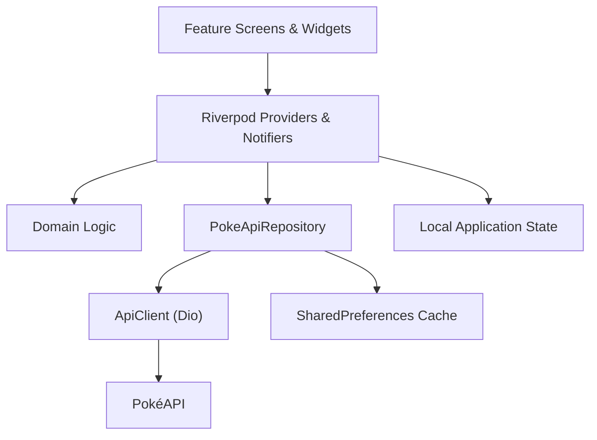

 <p align="center">
  
</p>

<h1 align="center">PokéPod</h1>

<p align="center">
  <strong>Beyond the Pokédex.</strong><br>
  An unofficial Pokémon research, challenge, and discovery companion built with Flutter.
</p>

<p align="center">
  <a href="https://drive.google.com/file/d/1mC15HkOd97j_yW7tOFx_2wqBNsXa5Kaf/view?usp=sharing"><strong>▶ Watch the Full App Demonstration</strong></a>
</p>

<p align="center">
  
  
  
  
  
  
  
  
</p>

<p align="center">
  <strong>1,025 Species</strong> &nbsp;·&nbsp;
  <strong>9 Generations</strong> &nbsp;·&nbsp;
  <strong>20 Achievements</strong> &nbsp;·&nbsp;
  <strong>4 Widget Sizes</strong> &nbsp;·&nbsp;
  <strong>327 Tests</strong>
</p>

---

## Overview

PokéPod reimagines the traditional Pokédex as an interactive research and discovery experience.

Rather than simply browsing Pokémon entries, trainers can explore detailed species dossiers, track research progress, analyse Pokémon, build teams, organise personal collections, and take part in a daily mystery challenge.

The application combines a structured Pokédex with research progression, interactive visualisations, achievements, and Android home-screen widgets.

<p align="center">
  
</p>

**Designed around three principles:**

- **Discover:** Explore the National Pokédex and learn about each species.
- **Research:** Record discoveries, study specimens, compare data, and analyse teams.
- **Collect:** Build collections, track achievements, and maintain a personal research profile.

PokéPod is local-first. Personal progress and preferences are stored on the device, without requiring an account or custom backend.

## Contents

- [Features](#features)
  - [Discover](#discover)
  - [Pokédex](#pokedex)
  - [Research Dossiers](#research-dossiers)
  - [Evolution Constellation](#evolution-constellation)
  - [Pokémon DNA](#pokemon-dna)
  - [Team Architect](#team-architect)
  - [Who's That Pokémon?](#whos-that-pokemon)
  - [Collections](#collections)
  - [Trainer Profile and Progression](#trainer-profile-and-progression)
  - [Android Home-Screen Widgets](#android-home-screen-widgets)
  - [Notifications and Sound](#notifications-and-sound)
  - [Settings, Backup, and Help](#settings-backup-and-help)
- [Architecture](#architecture)
- [Engineering Decisions](#engineering-decisions)
- [Data and Offline Behaviour](#data-and-offline-behaviour)
- [Daily Challenge Selection](#daily-challenge-selection)
- [Type Analysis](#type-analysis)
- [Technology Stack](#technology-stack)
- [Getting Started](#getting-started)
- [Verification](#verification)
- [Known Limitations](#known-limitations)
- [Privacy](#privacy)
- [Credits and Attribution](#credits-and-attribution)
- [License and Disclaimer](#license-and-disclaimer)

---

# Features

## Discover

The Discover screen provides a personalised overview of research activity and daily interactions.

- **Specimen of the Day:** A featured Pokémon shared with the Android home-screen widgets.
- **Daily Challenge:** Quick access to the daily Who's That Pokémon? challenge.
- **Research Progress:** A visual overview of overall research progression.
- **Recently Viewed:** Convenient access to previously opened specimens.
- **Upcoming Milestones:** A preview of research achievements.
- **Unexpected Connections:** Discover relationships between Pokémon through shared abilities, similar base-stat profiles, and common evolution families.

<p align="center">
  
</p>
<p align="center"><sub>Specimen of the Day — a rotating featured Pokémon and its research information.</sub></p>

## Pokédex

Browse the National Pokédex, covering all **1,025 Pokémon** across nine generations.

**Browsing and discovery**
- Incremental catalogue loading, displaying 30 entries at a time.
- Search by Pokémon name or National Pokédex number.
- Filter by type, generation, and favourites.
- Combine filters and clear them when needed.
- Switch between grid and list layouts.
- Skeleton loading, empty states, and retry handling.

**Sorting**

A dedicated sorting interface supports:
- Pokédex number
- Name
- Generation
- Type
- Legendary and Mythical status
- Favourites
- Height and weight
- Base statistics

Sorting direction adapts to the selected property.

**Living Dex**

An optional silhouette-based Living Dex view helps track collection progress.

<p align="center">
  
</p>
<p align="center"><sub>Pokédex — browse, search, filter, and organise the National Dex.</sub></p>

## Research Dossiers

Every Pokémon has a detailed research dossier containing:

- Official artwork and shiny artwork.
- Pokémon types.
- Height and weight.
- Individual base statistics and total base stats.
- Abilities, with hidden abilities clearly identified.
- Sample moves.
- English species descriptions.
- Evolution previews and links to the evolution visualisation.

Each specimen can progress through four research stages:

| Stage | Description |
|---|---|
| Unseen | Not yet discovered |
| Discovered | Dossier opened |
| Studied | Explicitly marked as studied |
| Mastered | Explicitly marked as mastered |

Opening a dossier automatically marks a Pokémon as Discovered. Studied and Mastered are deliberate actions.

Research dossiers also support personal notes, collections, Pokémon comparison, and showcase management.

## Evolution Constellation

Explore Pokémon evolution chains through an interactive visualisation.

- Interactive, pannable, and zoomable evolution graphs.
- Evolution branches, including complex families such as Eevee.
- Evolution requirements and conditions.
- Highlighting for the currently selected Pokémon.
- Select an evolution node to open its research dossier.

The visualisation is generated from PokéAPI evolution-chain data.

<p align="center">
  
</p>
<p align="center"><sub>Evolution Constellation — explore branching evolution families.</sub></p>

## Pokémon DNA

Compare two Pokémon through a structured statistical analysis.

The comparison includes:

- Individual base-stat bars and differences.
- Total base-stat comparison.
- Type and ability information.
- Defensive type profiles.
- Weaknesses, resistances, and immunities.

The analysis is intended to help trainers understand statistical and type-based differences. It does not claim that base statistics alone determine battle performance.

<p align="center">
  
</p>
<p align="center"><sub>Pokémon DNA — compare specimens through their statistics and defensive profiles.</sub></p>

## Team Architect

Create and analyse Pokémon teams with a maximum of six members.

**Team management**
- Create, rename, duplicate, and delete teams.
- Manage teams containing up to six Pokémon.
- Review team composition and defensive matchups.

**Team analysis**
- Defensive type coverage matrix.
- Offensive type coverage.
- Explainable suggestions to identify potential weaknesses and coverage gaps.

The offensive analysis uses Same-Type Attack Bonus (STAB) based on each Pokémon's own types. It does not simulate battles, movesets, or ability interactions.

<p align="center">
  
</p>
<p align="center"><sub>Team Architect — build teams and review their type coverage.</sub></p>

## Who's That Pokémon?

A daily Pokémon identification challenge designed around a persistent streak system.

**Gameplay**
- One selected Pokémon per local calendar day.
- Six guesses per challenge.
- Searchable Pokémon selection.
- Progressive clues, including generation, type, size, base-stat total, and species description.
- Name remains hidden during the challenge, with name length and first-letter hints.
- The Pokémon artwork gradually becomes clearer as incorrect guesses are made.

**Challenge completion**
- Correct guess or game over reveals the answer.
- Completed challenges are locked for that day.
- A completed day cannot be replayed by restarting the application.
- Current streak, best streak, total games, and win rate are tracked.
- Collapsible challenge history.

Daily selections use the full National Pokédex rather than repeatedly favouring a particular generation.

<p align="center">
  
</p>
<p align="center"><sub>Who's That Pokémon? — identify the daily specimen using progressive clues.</sub></p>

## Collections

Organise research discoveries into a personal collection system.

- Create and manage custom collections.
- Reorder collections.
- Pin favourite Pokémon.
- Build a personal Pokémon showcase.
- View Generation Dex Progress.
- Review research progress by Pokémon type.
- Access recently researched specimens.

The Generation Dex Progress view allows trainers to select a generation and review their progress. Research by Type provides a separate overview across the 18 Pokémon types.

<p align="center">
  
</p>
<p align="center"><sub>Collections — organise specimens, favourites, and research progress.</sub></p>

## Trainer Profile and Progression

The Trainer Profile brings personal identity and research progression together.

**Profile customisation**
- Custom trainer nickname.
- Pokémon avatar selection.
- Accent colour selection.
- System, Light, and Dark appearance modes.
- Research statistics and progression.
- Achievement preview.
- Research journal and saved-team access.

The profile menu provides access to Achievements, Research Journal, Settings, Help & User Guide, and About.

<p align="center">
  
</p>
<p align="center"><sub>Trainer Profile — customise your identity and review research activity.</sub></p>

### Achievements

PokéPod includes **20 achievements** tied to actual research and application progress.

Achievement progress is displayed through progress indicators and a nine-tier rarity system:

1. Common
2. Uncommon
3. Rare
4. Epic
5. Double Rare
6. Ultra Rare
7. Illustration Rare
8. Special Illustration Rare
9. Hyper Rare

### Research Journal

The Research Journal provides a dedicated place for personal research notes and saved teams.

<p align="center">
  
  &nbsp;&nbsp;&nbsp;
  
</p>
<p align="center"><sub>Achievements and Research Journal — track milestones and keep research notes.</sub></p>

## Android Home-Screen Widgets

PokéPod includes four Android home-screen widget sizes:

- Compact
- Small
- Medium
- Large

All sizes display the Specimen of the Day. Larger layouts provide additional information, including artwork, Pokémon name and number, type badges, species description, height, and weight.

**Adding a widget**

1. Long-press an empty area of the Android home screen.
2. Open the Widgets panel.
3. Find PokéPod.
4. Choose a widget size and place it on the home screen.

<p align="center">
  
</p>
<p align="center"><sub>Android Widgets — bring the Specimen of the Day to your home screen.</sub></p>

## Notifications and Sound

**Local notifications**
- Optional daily reminders.
- Optional streak reminders.
- Local-timezone scheduling.
- An in-app explanation before requesting notification permission.
- No push notification service or custom notification backend.

**Sound effects**
- Launch splash sound.
- Daily challenge sound effects.
- Sound preference available in Settings.
- Sound playback stops when the application is paused or detached.

## Settings, Backup, and Help

### Settings

Control application preferences, including:

- System, Light, and Dark themes.
- Accent colour.
- Sound preferences.
- Data-related options.

<p align="center">
  
</p>
<p align="center"><sub>Settings — manage appearance, accent colours, sound, and preferences.</sub></p>

### Backup and Restore

PokéPod provides a local backup and restore workflow.

**Backup**
- Export progress as a versioned backup.
- Copy the backup data to the clipboard.

**Restore**
- Validate backup structure and version.
- Preview the data before restoring.
- Require confirmation before replacing existing progress.

<p align="center">
  
</p>
<p align="center"><sub>Backup and Restore — preserve and recover local research progress.</sub></p>

### Help & User Guide

A searchable, collapsible guide explains the application's features and how to use them.

<p align="center">
  
  &nbsp;&nbsp;&nbsp;
  
</p>
<p align="center"><sub>Help & User Guide and About — in-app guidance, credits, and project information.</sub></p>

The About section includes project information, data-source credits, an open-source licences page, and the unofficial fan-project disclaimer.

---

# Architecture

PokéPod follows a feature-first Flutter architecture with a separation between presentation, application state, data access, and pure Dart domain logic.



## Project Structure

```text
lib/
├── main.dart
├── app/
│   ├── app.dart
│   ├── shell.dart
│   ├── theme/
│   └── design_system/
│       └── widgets.dart
├── core/
│   ├── errors/
│   ├── networking/
│   ├── storage/
│   └── utils/
├── data/
│   ├── models/
│   ├── repositories/
│   └── providers.dart
├── domain/
└── features/
    ├── discover/
    ├── pokedex/
    ├── pokemon_detail/
    ├── evolution/
    ├── analysis/
    ├── team_builder/
    ├── mystery/
    ├── collections/
    ├── trainer_profile/
    ├── research/
    ├── notifications/
    ├── widgets/
    ├── help/
    └── shared/

test/
```

**Directory responsibilities**

| Directory | Responsibility |
|---|---|
| `app/` | Application configuration, navigation shell, themes, and shared design system |
| `core/` | Networking, storage, errors, and utilities |
| `data/` | API models, repositories, caching, and providers |
| `domain/` | Pure Dart application rules and analysis |
| `features/` | Feature-specific screens, widgets, and state |
| `test/` | Unit and widget tests |

# Engineering Decisions

### State Management

Riverpod provides application state management and dependency injection. GetIt was removed in favour of a consistent Riverpod-based approach.

### Repository Layer

`PokeApiRepository` separates API access from presentation logic.

It provides:
- Cache-first data access.
- In-flight request de-duplication.
- Compact persistent caching.
- A repository boundary that can be tested with a fake API client.

### Defensive Data Models

Hand-written models handle missing or malformed API fields rather than assuming every response is complete.

### Pure Dart Domain Logic

Core rules are separated from Flutter widgets, including:

- Pokémon type effectiveness.
- Team analysis.
- Research progression.
- Mystery challenge selection and streak logic.
- Pokédex filtering and sorting.
- Unexpected Connections.
- Evolution graph layout.
- Achievement progression.

### Navigation

A swipeable `PageView` provides navigation between the five primary sections. The selected tab is shared with the bottom navigation bar and navigation shortcuts. Deeper screens use Navigator push navigation.

### Local Persistence

SharedPreferences stores application data in JSON-compatible formats. Stored data is loaded before the application starts.

# Data and Offline Behaviour

PokéPod uses [PokéAPI](https://pokeapi.co/) as its primary Pokémon data source.

**Catalogue**
- The catalogue is retrieved through a consolidated names-and-numbers request.
- Pokémon artwork URLs are derived from National Pokédex numbers.
- Catalogue tiles do not require an individual API request for every Pokémon.

**Detailed data**
- Pokémon details, species information, evolution chains, and type information are loaded when needed.
- Retrieved data is cached in memory and on disk using compact representations.

**Offline behaviour**
- Previously opened data can be served from cache.
- First-time data retrieval requires an internet connection.
- If a request fails, the application can display an offline state and offer retry.
- Unavailable information is not replaced with fabricated data.
- Artwork already loaded may remain available through image caching; artwork never loaded before going offline cannot be guaranteed.

# Daily Challenge Selection

The daily mystery challenge uses the device's local calendar date.

Selection is designed around the full National Pokédex:

1. A date-seeded deterministic shuffle establishes the Pokémon order.
2. Each day advances through that order.
3. A complete cycle covers all 1,025 species before repeating.
4. The daily answer is saved when the challenge is first opened.
5. The saved answer cannot be changed by restarting the application.

Additional safeguards:
- Completed challenges cannot be replayed.
- Duplicate or invalid guesses are ignored.
- Earlier dates cannot be reopened once a later challenge has been played.
- The challenge checks for local midnight rollover, including when the application returns from the background.

The schedule is device-based. It does not use a server to enforce time, so changing the device clock cannot be completely prevented.

# Type Analysis

The type-analysis engine is implemented in:

```text
lib/domain/type_chart.dart
```

It supports the 18 Pokémon types using the modern type chart introduced in Generation VI.

Supported effectiveness multipliers:

| Multiplier | Effect |
|---:|---|
| `0×` | Immune |
| `¼×` | Quarter damage |
| `½×` | Half damage |
| `1×` | Normal damage |
| `2×` | Super effective |
| `4×` | Double super effective |

For dual-type Pokémon, the two defensive type multipliers are combined.

Team Architect's offensive coverage uses STAB-based type coverage. It assumes Pokémon use moves corresponding to their own types. It does not track actual movesets or simulate battles.

---

# Technology Stack

| Technology | Purpose |
|---|---|
| Flutter | Cross-platform UI framework |
| Dart | Application language |
| `flutter_riverpod` | State management and dependency injection |
| `dio` | HTTP requests, timeouts, retries, and cancellation |
| `shared_preferences` | Local persistence and cache |
| `cached_network_image` | Pokémon artwork loading and caching |
| `audioplayers` | Sound effects |
| `home_widget` | Android home-screen widgets |
| `flutter_local_notifications` | Local reminders |
| `flutter_timezone` | Device timezone information |
| PokéAPI | Pokémon data source |

# Getting Started

## Prerequisites

- Flutter SDK 3.47.4 or compatible.
- Dart SDK `^3.10.0`.
- Android Studio.
- Android SDK and an emulator or physical Android device.

A physical Android device is recommended when testing home-screen widgets and notification behaviour.

## Installation

Clone the repository:

```bash
git clone <your-repository-url>
cd pokepod
```

Install dependencies:

```bash
flutter pub get
```

Run the application:

```bash
flutter run
```

Run commands from the directory containing `pubspec.yaml`. The repository includes `pubspec.lock` to preserve the resolved dependency versions.

## Code Quality and Tests

Format the code:

```bash
dart format .
```

Run static analysis:

```bash
flutter analyze
```

Run the test suite:

```bash
flutter test
```

## Build APKs

Debug build:

```bash
flutter build apk --debug
```

Release build:

```bash
flutter build apk --release
```

**Release signing:** The current release configuration uses the debug signing setup inherited from the project template. Configure your own Android signing keystore before publishing. Never commit keystores or signing credentials to source control.

---

# Verification

The following reflects the project's **last recorded verification**, not a claim that these checks were rerun for this README revision.

| Check | Last recorded result |
|---|---|
| Flutter environment | Flutter 3.47.4, Windows, JDK 21, Android SDK 36 |
| `flutter pub get` | Passed |
| `dart format lib test` | Passed — 89 files, 0 changed |
| `flutter analyze` | No issues found |
| `flutter test` | Passed — 327 tests |
| Android debug APK | Built successfully |
| Android release APK | Built successfully |

**Platform verification:** Android builds were recorded as successful. iOS, web, macOS, Linux, and Windows builds were not recorded as tested.

To reproduce the checks, run the commands in [Getting Started](#getting-started) using your local Flutter environment.

# Known Limitations

- The Pokédex covers National Dex entries 1–1025. Alternate forms are not comprehensively represented.
- Sample moves display a limited selection rather than complete competitive movesets.
- Team offensive analysis uses STAB-based type coverage and does not simulate battles, movesets, or ability interactions.
- Some sorting properties, including type, size, base statistics, and Legendary/Mythical status, require additional data beyond the initial catalogue. Missing information is loaded when needed.
- Research by Type may require up to 18 small type-data requests.
- Persistent cache uses SharedPreferences and is not intended for large-scale data storage or automatic full refresh.
- Home-screen widgets and local reminders are Android-specific.
- Daily challenge selection is based on the device clock; server-side time enforcement is not implemented.
- Backup and restore currently use the clipboard rather than file export, cloud storage, or cross-device synchronisation.
- Release signing must be configured with a production keystore before distribution.

# Privacy

PokéPod is designed as a local-first application.

- No account registration is required.
- No custom application backend is used.
- No analytics or advertising service is included.
- Research progress, favourites, collections, teams, notes, profile settings, and daily challenge records are stored locally.
- Pokémon data and artwork requests connect to PokéAPI and the relevant GitHub-hosted artwork resources. Those services may receive the device's IP address as part of normal network communication.
- Backups are copied to the clipboard. They are not automatically uploaded to a server.
- Uninstalling the application or clearing its data removes locally stored progress. Create a backup before doing so if you want to preserve your data.

# Credits and Attribution

PokéPod is made possible by the following resources:

- **[PokéAPI](https://pokeapi.co/)** — Pokémon species, statistics, abilities, types, and evolution data.
- **[PokéAPI Sprites](https://github.com/PokeAPI/sprites)** — Pokémon artwork used by the application.
- **Bundled sound effects** — Sound files included in `assets/sounds/` were sourced through Zedge. Their redistribution terms have not been independently confirmed.
- **PokéPod wordmark** — Supplied by the author.

Pokémon artwork is loaded from external sources at runtime; Pokémon artwork is not stored as original project artwork in the repository.

Third-party package and licence details are documented in `THIRD_PARTY_NOTICES.md`. The in-app About section also provides access to the open-source licences page.

# License and Disclaimer

## License

The original source code authored for PokéPod is released under the [MIT License](./LICENSE).

The MIT licence applies to the original project code only. It does not grant rights to Pokémon trademarks, characters, artwork, or third-party assets and dependencies, which remain subject to their respective owners' rights and licence terms.

## Unofficial Fan Project

PokéPod is an unofficial, non-commercial fan project. It is not affiliated with, endorsed by, sponsored by, or associated with Nintendo, The Pokémon Company, or Game Freak.

Pokémon and all related names, characters, imagery, and trademarks belong to their respective owners. No ownership of Pokémon intellectual property is claimed.

---

<p align="center">
  <strong>PokéPod — Beyond the Pokédex.</strong><br>
  Built with Flutter by <a href="https://github.com/ShakyaJU">ShakyaJU</a>.
</p>
